<div align="center">

# Podcast Studio

### Turn a textbook chapter into a fact-checked, two-host podcast in 23 languages

Upload a chapter, pick a language, and two animated hosts talk it through. Every line they say is checked against the chapter.


<sub>The clip and the interface screenshots below were recorded in <b>demo mode</b> (offline stand-in models, beep voices), so they show the interface and the checks working, not the quality of real model output. The three <a href="#real-runs-in-three-languages">language examples</a> are real runs.</sub>

</div>

---

## Table of contents

1. [Overview](#overview)
2. [Key features](#key-features)
3. [Multilingual output](#multilingual-output)
4. [Interface tour](#interface-tour)
5. [How it works](#how-it-works)
6. [Getting started](#getting-started)
7. [Usage](#usage)
8. [Configuration](#configuration)
9. [Codebase overview](#codebase-overview)
10. [Documentation](#documentation)
11. [Testing and code quality](#testing-and-code-quality)
12. [Security and privacy](#security-and-privacy)
13. [Limitations](#limitations)
14. [Roadmap](#roadmap)
15. [Contributing](#contributing) · [License](#license) · [Acknowledgements](#acknowledgements)

---

## Overview

Students often meet a textbook chapter only as a wall of text. **Podcast Studio** turns one into a lively conversation between two hosts, in English, Hindi or any of 21 other Indian languages, so it can be listened to, read along with, and studied from.

The hard part is trust. A fluent model will happily add a fact the chapter never states. This project is built around one rule: **the hosts never say something the chapter does not say.**

- The chapter is cut into **numbered paragraphs** once. Every planned point and every script line points back to them.
- A fixed rule rejects any **number** that is not in the chapter, and a second model **fact-checks** every segment.
- Problems go back to the writer for repair (up to two rounds). A segment that still fails is flagged **needs review**, never hidden.
- The same safeguards protect the quiz, the spoken answers to listener questions and the video slides.

Built as the *Podcast Generation* project for **DA7016 · Recent Advances in Generative AI** (AI4Bharat).

| | |
|---|---|
| **Input** | PDF, `.txt` or `.md` chapter (or pasted text) |
| **Output** | MP3 and WAV audio, Markdown transcript, SRT and VTT subtitles, optional narrated MP4, study pack, quality report |
| **Languages** | English plus 22 Indian languages, 45 voices |
| **Models** | Chat models through [OpenRouter](https://openrouter.ai); voices and translation through [Bodhan](https://console.bodhan.ai) |
| **Stack** | Python 3.11+, FastAPI, pydantic, vanilla JavaScript, three.js, ffmpeg, headless Chromium (video only) |

---

## Key features

| Feature | Details |
|---|---|
| **Faithful to the chapter** | Numbered source paragraphs, a number-grounding rule, a second-model fact-check and an automatic repair loop. Unresolved segments are marked *needs review*. |
| **23 languages** | Write directly in the language, or write in English and translate. The English text stays as the master copy that the checks run against. |
| **Natural conversation** | Two hosts with their own voices and delivery styles, short reactions, overlaps, natural pacing, a jingle and loudness normalisation. |
| **Fix one segment, not the episode** | Rewrite a segment (optionally with an instruction), re-voice it, edit a single line, or revert to an earlier version. Only that segment is redone. |
| **3D hosts on stage** | Two animated 3D characters (three.js) lip-sync to the audio, blink, gesture and listen while the other speaks. Degrades gracefully without WebGL. |
| **Study pack** | Quiz, takeaways and glossary. Every item cites its paragraph and is verified by a second model. Printable study sheet. |
| **Ask the hosts** | Type a question and the hosts answer in their own voices, only from the chapter, or say honestly that it is not covered. The answer is performed on the 3D stage. |
| **Quality dashboard** | Validator score (0-100), fact-check outcomes, chapter-coverage map, host balance, cost and a printable evidence report. |
| **Narrated video** (optional) | Slides, the chapter's own figures and live captions, timed to the audio and built from the script, encoded to MP4. |
| **Resumable and economical** | State is saved after every step; a stopped run continues where it left off. Voice clips and video frames are cached. |
| **Demo mode** | `--mock` runs the whole app offline with no keys and no credits. |
| **Developer tooling** | `doctor` checks every key and model, `tune trials` compares models, `validate` scores any episode, a documented REST API, 180+ offline tests. |

---

## Multilingual output

Podcast Studio supports **English and 22 Indian languages**. The *writing reliability* column says how dependably general-purpose chat models write natural conversational text in that language (it controls how much extra guidance the prompts add); it is not a measure of voice quality.

| Code | Language | Native name | Script | Writing reliability |
|---|---|---|---|---|
| `en` | English | English | Latin | strong |
| `hi` | Hindi | हिन्दी | Devanagari | strong |
| `bn` | Bengali | বাংলা | Bengali | strong |
| `gu` | Gujarati | ગુજરાતી | Gujarati | strong |
| `kn` | Kannada | ಕನ್ನಡ | Kannada | strong |
| `ml` | Malayalam | മലയാളം | Malayalam | strong |
| `mr` | Marathi | मराठी | Devanagari | strong |
| `pa` | Punjabi | ਪੰਜਾਬੀ | Gurmukhi | strong |
| `ta` | Tamil | தமிழ் | Tamil | strong |
| `te` | Telugu | తెలుగు | Telugu | strong |
| `ur` | Urdu | اردو | Perso-Arabic (Nastaliq) | strong |
| `ne` | Nepali | नेपाली | Devanagari | moderate |
| `or` | Odia | ଓଡ଼ିଆ | Odia | moderate |
| `as` | Assamese | অসমীয়া | Bengali-Assamese | moderate |
| `sa` | Sanskrit | संस्कृतम् | Devanagari | moderate |
| `mai` | Maithili | मैथिली | Devanagari | moderate |
| `kok` | Konkani | कोंकणी | Devanagari | moderate |
| `doi` | Dogri | डोगरी | Devanagari | limited |
| `brx` | Bodo | बड़ो | Devanagari | limited |
| `ks` | Kashmiri | کٲشُر | Perso-Arabic | limited |
| `mni` | Manipuri (Meitei) | ꯃꯩꯇꯩꯂꯣꯟ | Meetei Mayek | limited |
| `sat` | Santali | ᱥᱟᱱᱛᱟᱲᱤ | Ol Chiki | limited |
| `sd` | Sindhi | سنڌي | Perso-Arabic | limited |

Any of the 45 voices can read any language, so you choose each host's voice independently of the language.

### Writing modes

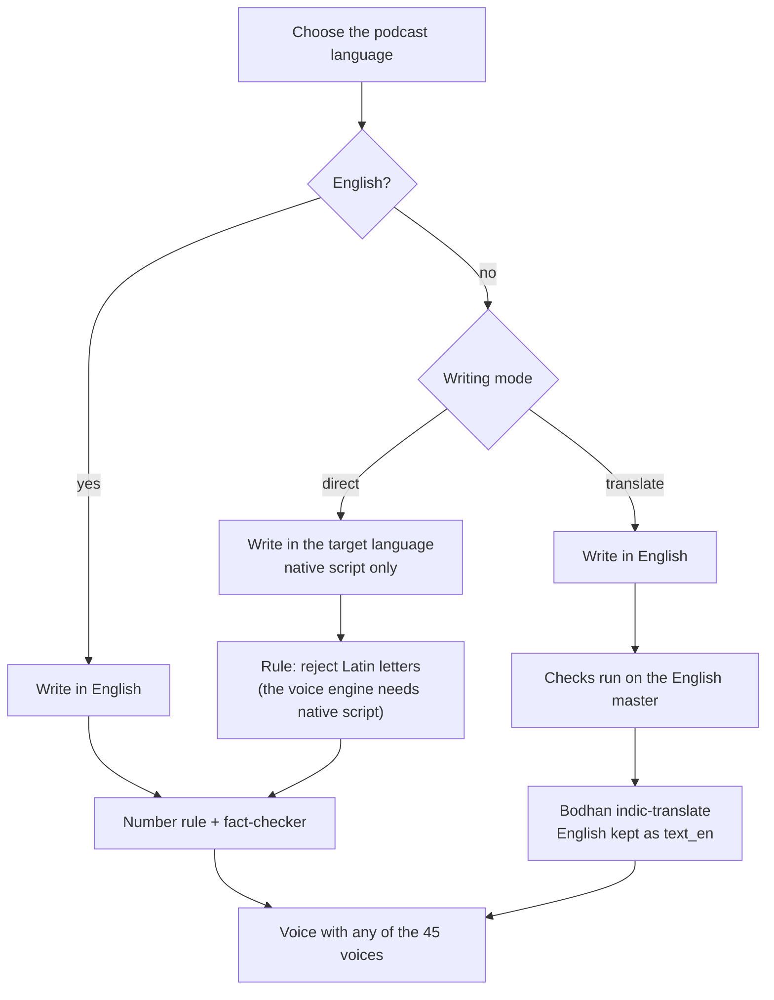

- **Direct** is the default: the model writes in the target language and a rule rejects lines containing Latin letters, because the voice engine needs native script.
- **Translate** suits languages where chat models write less reliably: the script is written and fact-checked in English, then translated with Bodhan's `indic-translate`. The English text is kept as the master copy.

### Real runs in three languages

These screenshots come from real runs with real keys (OpenRouter models and Bodhan voices), not demo mode. Each shows the 3D hosts performing a line in the episode's own language, with the *Who speaks when* timeline below the stage.

**Telugu** · written directly · pasted text

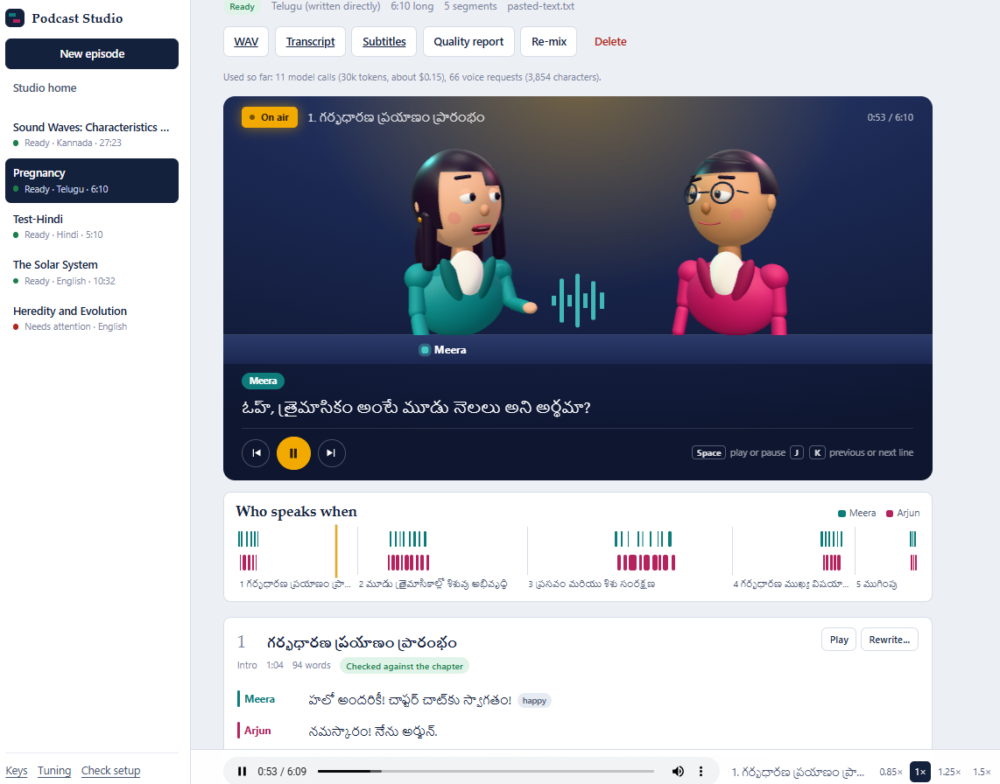

**Kannada** · written directly · uploaded PDF · 13 segments

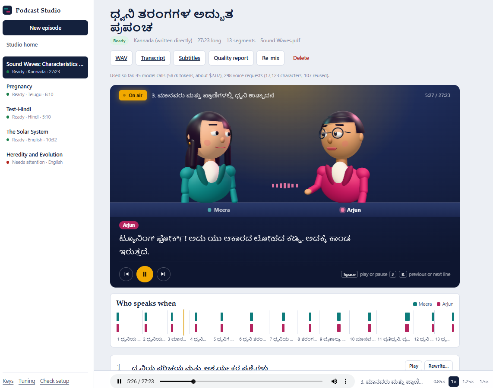

**Hindi** · written directly · pasted text

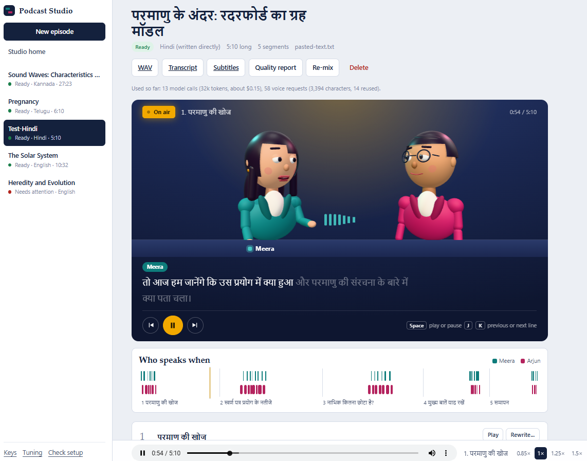

| Language | Chapter | Length | Segments | Model calls | Tokens | Voice requests | Model cost (est.) |
|---|---|---|---|---|---|---|---|
| Telugu | *Pregnancy* (pasted text) | 6:10 | 5 | 11 | 30k | 66 (3,854 chars) | about $0.15 |
| Kannada | *Sound Waves* (PDF) | 27:23 | 13 | 45 | 587k | 298 (17,123 chars, 107 reused) | about $2.07 |
| Hindi | *Inside the atom: Rutherford's planetary model* (pasted text) | 5:10 | 5 | 13 | 32k | 58 (3,394 chars, 14 reused) | about $0.15 |

<sub>Figures are the usage counters shown by the app for each episode. The cost is the app's estimate for the chat models only. These are single example runs, not a benchmark, and the validator checks structure, grounding and audio levels, not pronunciation. Naturalness and accuracy in each language are best judged by native speakers.</sub>

---

## Interface tour

> The screenshots in this section are from **demo mode**: an offline stand-in writes the script and "speaks" with beeps, so the text is simple. The layout, checks, scores and interactions are the real application.

### Start

<table>
<tr>
<td width="62%"></td>
<td width="38%" valign="top">

**Welcome screen.** Two clear choices: open an existing episode or create a new one. While you decide, the two hosts rehearse a short sample conversation and a badge shows a line being matched to the chapter.

</td>
</tr>
</table>

### Create an episode

<table>
<tr>
<td width="50%"></td>
<td width="50%"></td>
</tr>
<tr>
<td><sub><b>New episode.</b> Upload a PDF or text, or paste it. Pick the language, length, hosts and voices (<i>Listen</i> previews a voice).</sub></td>
<td><sub><b>Studio home.</b> Every episode with its status, language, length and a who-speaks-when strip.</sub></td>
</tr>
</table>

### Listen, read, fix


<sub><b>Episode page.</b> The 3D hosts perform the episode while captions highlight each word and the player follows along (<kbd>Space</kbd> play/pause, <kbd>J</kbd> / <kbd>K</kbd> previous / next line).</sub>

<table>
<tr>
<td width="55%"></td>
<td width="45%" valign="top">

**Segment by segment.** Every segment shows its lines, length and a *Checked against the chapter* badge. Open **What this segment must cover** to see the planned key points and the chapter paragraphs it may use. Use **Rewrite...** (optionally with an instruction such as "add a real-life example"), **Play**, **Edit** a single line, or revert to an earlier version. Only that segment is redone.

</td>
</tr>
</table>

### Learn, ask, check

<table>
<tr>
<td width="50%"></td>
<td width="50%"></td>
</tr>
<tr>
<td><sub><b>Study pack.</b> Quiz, takeaways and glossary. A wrong answer shows the exact chapter sentence and a "See it in the chapter" link.</sub></td>
<td><sub><b>Ask the hosts.</b> Answers come only from the matching chapter paragraphs. Off-topic questions are declined, not guessed.</sub></td>
</tr>
</table>

<table>
<tr>
<td width="50%"></td>
<td width="50%"></td>
</tr>
<tr>
<td><sub><b>Performed on stage.</b> An answer replaces the player's audio so the hosts' mouths and captions follow it.</sub></td>
<td><sub><b>Quality tab.</b> Score, fact-check outcomes, chapter coverage and every individual check.</sub></td>
</tr>
</table>

<table>
<tr>
<td width="55%"></td>
<td width="45%" valign="top">

**Printable evidence report.** The same numbers on one page: what was checked and how, the fact-check loop, per-segment results and every validation check with PASS / WARN / FAIL. Demo-mode episodes carry a visible banner so their numbers are never mistaken for evidence of real model quality.

</td>
</tr>
</table>

### On a phone

<p align="center"></p>

---

## How it works


<sub>Solid arrows: the generation pipeline. Dashed green: extra features, which only read what the pipeline already produced. Amber: the safeguard that decides whether a script line may be spoken; the same check guards the answers in *Ask the hosts*.</sub>

The diagrams below are [Mermaid](https://mermaid.js.org), so GitHub renders them directly. [`docs/ARCHITECTURE.md`](docs/ARCHITECTURE.md) has the same diagrams with the reasoning behind each design decision.

### 1. System overview

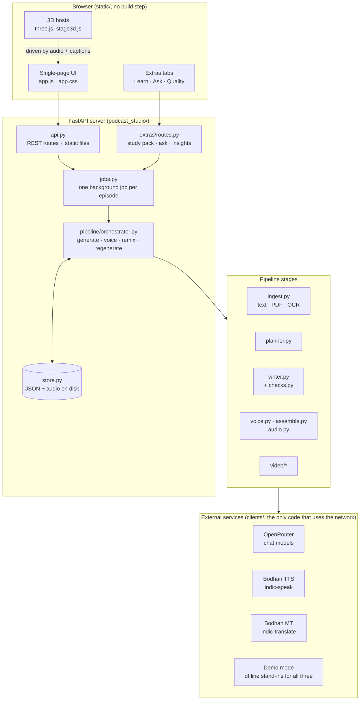

| Layer | Files | Responsibility |
|---|---|---|
| Web UI | `static/app.js`, `extras.js`, `stage3d.js` | Plain JavaScript, no framework. The 3D hosts are the only built asset. |
| HTTP | `api.py`, `extras/routes.py` | Thin: validate input, start a job, return stored data. |
| Jobs | `jobs.py` | One background job per episode (a second request gets `409`), progress polling, cooperative cancel. |
| Orchestration | `pipeline/orchestrator.py` | Sequences the stages and saves after every step so a run can resume. |
| Stages | `ingest.py`, `pipeline/*`, `video/*`, `extras/*` | One module per stage, each testable on its own. |
| Clients | `clients/*` | The only code that uses the network. `mock.py` is an offline twin for demo mode and tests. |
| Storage | `store.py`, `models.py` | Pydantic models saved as one `project.json` per episode, written atomically. |

### 2. Generation pipeline

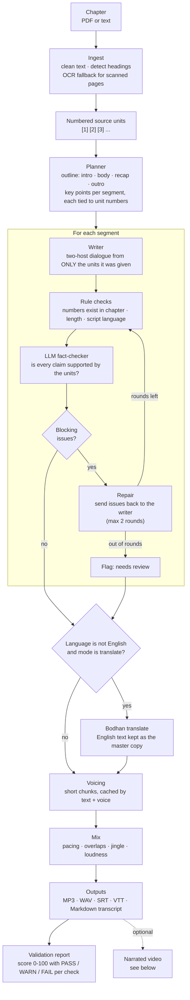

### 3. Fact-check and repair loop

The loop lives in [`pipeline/writer.py`](podcast_studio/pipeline/writer.py) (`ScriptWriter.write`).

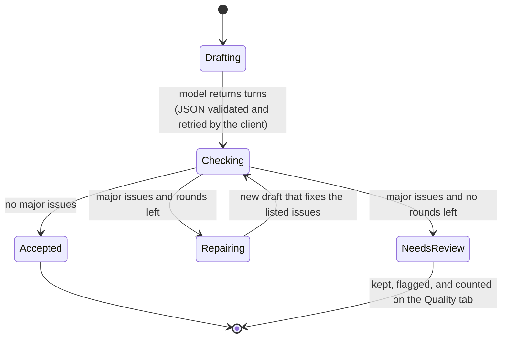

| Check | Type | What it catches |
|---|---|---|
| Numbers rule | rule | Any figure spoken that is not in the chapter or the segment's key points (Indic digits are normalised first). Always a major issue. |
| Script rule | rule | Latin letters inside a Hindi, Tamil, ... line (the voice engine needs native script); turns over 95 words. |
| Length rule | rule | A segment far over (more than 2x) or far under (less than 40%) its target length. |
| Fact-checker | model | A claim the cited paragraphs do not support, and planned key points missing from the dialogue. Returns issues with a severity and a suggested fix. |

### 4. What happens when you create an episode

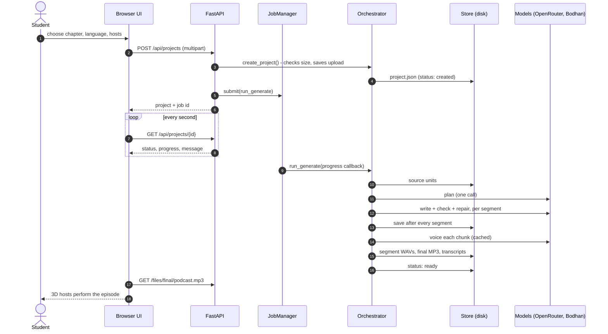

### 5. Episode life cycle

An episode's `status` only ever takes these values, so the UI and the resume logic are written against a closed set.

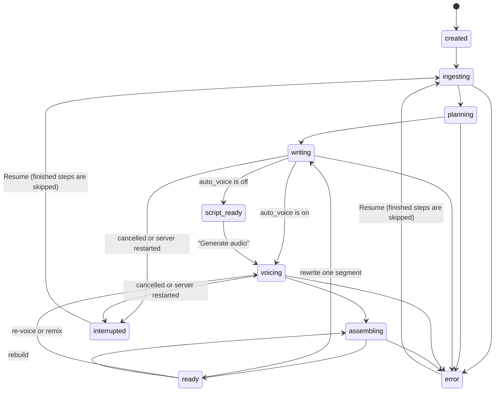

### 6. Study pack, Ask the hosts and Quality tab

These features live in `podcast_studio/extras/`, are mounted by one function call, and reuse the pipeline's safeguards. Every one has an offline twin for demo mode.

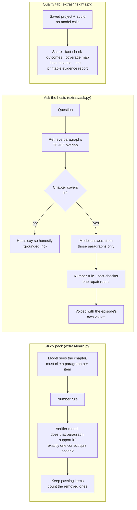

### 7. Narrated video

The video is built **after** the audio is finished, so a video failure can never damage the episode.

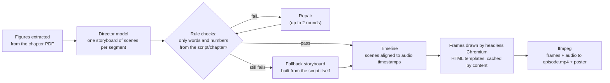

### 8. Data model

Everything an episode needs is one `project.json` plus audio files, validated by the pydantic models in [`models.py`](podcast_studio/models.py). The full diagram is in [`docs/DATA_MODEL.md`](docs/DATA_MODEL.md) and JSON Schemas are in [`docs/schemas/`](docs/schemas).

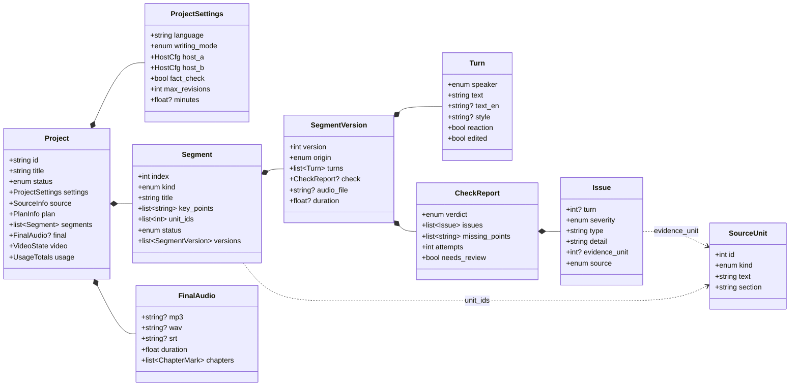

### 9. Storage layout

```text
data/                               (git-ignored)
├── projects/<episode-id>/
│   ├── project.json                all state: settings, plan, segments, versions, checks, usage
│   ├── source/                     the upload, extracted text, numbered units
│   ├── segments/segNN_vK.wav       audio of segment NN, version K (older versions are kept)
│   ├── final/                      podcast.mp3 · podcast.wav · transcript.md / .srt / .vtt
│   ├── reports/validation.json     the last quality report
│   ├── extras/                     learn.json · history.json · ask_NNN.wav
│   └── video/                      episode.mp4 · poster.jpg · scenes/
└── cache/
    ├── tts/                        voice chunks keyed by (model, voice, language, style, text)
    ├── frames/                     rendered video frames keyed by content
    └── pages/                      rendered PDF pages (figures and OCR)
```

---

## Getting started

### Prerequisites

| Requirement | Needed for |
|---|---|
| **Python 3.11 or newer** | Everything |
| **ffmpeg** | MP3 output and loudness matching (without it you still get WAV) |
| Chrome, Edge or Playwright's Chromium | The optional narrated video only |
| OpenRouter and Bodhan API keys | Real episodes (not needed for demo mode) |

Install ffmpeg with `winget install Gyan.FFmpeg` (Windows), `brew install ffmpeg` (macOS) or `sudo apt install ffmpeg` (Debian/Ubuntu), then reopen the terminal.

### Try it first, with no keys (demo mode)

```bash
git clone https://github.com/Mahith2203/Podcast-Generation-DA7016.git
cd Podcast-Generation-DA7016
python -m venv .venv
# Windows:  .venv\Scripts\activate        macOS / Linux:  source .venv/bin/activate
pip install -r requirements.txt
python -m podcast_studio.cli --mock serve
```

Open <http://127.0.0.1:8000>, choose **Create a new episode**, then **Paste text**, and paste the contents of [`samples/water_cycle.txt`](samples/water_cycle.txt). You get a full episode with beep voices in about a minute.

### Real episodes

```bash
cp .env.example .env                  # Windows: copy .env.example .env
# paste your keys into .env (see the table below), then:
python -m podcast_studio.cli keys     # shows which keys are set (last 4 characters only)
python -m podcast_studio.cli doctor   # tests every key, model, voice and tool separately
python -m podcast_studio.cli serve    # http://127.0.0.1:8000
```

Shortcuts: on **Windows**, double-click `start.bat` (creates the environment, installs packages, opens `.env` in Notepad, checks the keys and opens the app). On **macOS / Linux**, run `./start.sh`.

### API keys

Keys go in `.env`, copied from [`.env.example`](.env.example). **`.env` is git-ignored and must never be committed.** You can also paste keys in the app (**Keys**, bottom-left) without restarting.

| Line in `.env` | Needed? | What it is | Where to get it |
|---|---|---|---|
| `OPENROUTER_API_KEY` | required | Chat models that plan, write and fact-check | [openrouter.ai/keys](https://openrouter.ai/keys) (starts with `sk-or-`) |
| `BODHAN_TTS_API_KEY` | required | Voices, model **indic-speak** | console.bodhan.ai → API keys |
| `BODHAN_MT_API_KEY` | optional | Translation, model **indic-translate**; only for the *translate* writing mode | console.bodhan.ai → API keys |
| `BODHAN_OCR_API_KEY` | reserved | Not used yet (scanned PDFs use the OpenRouter vision model) | |

Several keys for one line can be separated by commas; if one is rejected or out of credit, the next is used automatically. `doctor` tests every key separately, so you can see exactly which one is dead.

---

## Usage

### Web app

1. **Create a new episode.** Upload or paste a chapter; choose language, length, hosts and voices.
2. **Watch progress.** Reading, planning, writing and checking each segment, then voicing and mixing. You can stop and resume at any time.
3. **Listen and read.** The 3D hosts perform the episode with synced captions. Download MP3, WAV, transcript (Markdown) or subtitles (SRT, VTT).
4. **Fix what you don't like.** Rewrite, re-voice, edit a line or revert, per segment.
5. **Study.** *Learn* has the quiz, takeaways and glossary; *Ask* lets you put your own question to the hosts.
6. **Check quality.** The *Quality* tab and the printable evidence report show what was verified and what needs review.

### Command line

Everything the app does is available from the terminal: `python -m podcast_studio.cli <command>`. Add `--mock` before the command for demo mode.

| Command | What it does |
|---|---|
| `serve [--port N]` | Start the web app |
| `doctor` | Check keys, models, voices, translation, ffmpeg and video tools |
| `keys` / `setup` | Show which keys are set / guided key setup |
| `generate FILE [--lang hi] [--minutes 4] [--video] [--out DIR]` | Make an episode from a file |
| `list` | List episodes |
| `resume ID` | Continue an interrupted or failed episode |
| `regen ID N [-i "instruction"] [--revoice]` | Rewrite or re-voice segment N |
| `edit ID N LINE --text "..."` | Hand-edit one line |
| `validate [ID] [--deep]` | Quality report; `--deep` re-checks every claim with the model |
| `tune show \| set \| preset \| trials \| voices \| remix` | Pacing and creativity knobs, model comparison, voice samples |
| `video [ID]` / `vregen ID N` | Make the narrated video / redo one segment's visuals |
| `export ID --out DIR` | Copy the finished files |
| `voices`, `models QUERY` | Browse voices and OpenRouter models |

```bash
# a 4-minute Hindi episode, written directly in Hindi, from a PDF
python -m podcast_studio.cli generate chapter.pdf --lang hi --minutes 4 --out out

# compare creativity levels on your own chapter, script only (no voice credits)
python -m podcast_studio.cli tune trials --file samples/water_cycle.txt --temps 0.5,0.85,1.0

# rewrite segment 3 with an instruction
python -m podcast_studio.cli regen <id> 3 -i "add a real-life example"
```

`validate` scores five areas with PASS / WARN / FAIL per check: **structure**, **faithfulness** (numbers, key points, coverage, open issues), **naturalness** (turn length, back-and-forth, reactions, host balance, repetition), **audio** (length, clipping, level, silence, MP3) and **outputs** (subtitles match the script, chapter marks in order).

### Narrated video (optional)

Turns a finished episode into an MP4: slides that appear as the hosts say them (key terms, bullet points, numbered steps, cycles with arrows, comparison tables, big numbers, the chapter's own figures, recap), live captions with the speaker's name, and cross-fades, all timed to the audio.

```bash
python -m playwright install chromium      # ~150 MB; not needed if Edge or Chrome is installed
python -m podcast_studio.cli doctor        # should show "Video renderer" and "Video encoder"
python -m podcast_studio.cli video <id> --res 720p --theme dark
```

The director model may only use words and numbers from the script and the chapter; rules verify this, problems go back for repair, and anything still wrong is replaced by a safe slide built from the script itself.

---

## Configuration

| Where | What |
|---|---|
| [`.env`](.env.example) | Keys, model names (`LLM_MODEL_WRITER`, `LLM_MODEL_CHECKER`, ...), `TTS_CONCURRENCY`, `DATA_DIR`, `MOCK_APIS` |
| [`tuning.json`](tuning.example.json) | How it sounds and reads: temperatures, speaking speed, pauses, overlaps, loudness, jingle. Also the **Tuning** button in the app. Presets: `faithful`, `balanced`, `lively`, `calm`. Out-of-range values are clamped, so typos cannot break a run. |
| Per episode | Language, length, hosts and voices, fact-check on/off, review the script before voicing, extra instructions |

---

## Codebase overview

```text
Podcast-Generation-DA7016/
├── podcast_studio/              the Python package (~9,000 lines)
│   ├── api.py                   FastAPI app: REST routes, job submission, static files
│   ├── cli.py                   command-line interface
│   ├── models.py                pydantic data model: Project, Segment, Turn, CheckReport, ...
│   ├── store.py                 one JSON file + audio per episode, atomic writes
│   ├── jobs.py                  background jobs: one per episode, progress, cancel
│   ├── config.py · keys.py      settings from .env, key rotation and masking
│   ├── ingest.py · text.py      PDF/text to clean numbered paragraphs, OCR fallback, text helpers
│   ├── prompts.py               every prompt sent to a model, in one place
│   ├── voices.py                languages, voices, delivery styles
│   ├── audio.py                 WAV/MP3 helpers: trim, level, overlay, loudness, jingle
│   ├── validate.py              the 0-100 quality validator
│   ├── doctor.py · setup_wizard.py · tune.py · tuning.py
│   ├── pipeline/
│   │   ├── orchestrator.py      generate / voice / remix / regenerate, resumable
│   │   ├── planner.py           outline + key points tied to source paragraphs
│   │   ├── writer.py            dialogue per segment + the fact-check and repair loop
│   │   ├── checks.py            rule checks and the LLM fact-checker
│   │   ├── voice.py             chunking, cached TTS, pacing
│   │   └── assemble.py          mix, chapter marks, MP3/WAV, SRT/VTT/Markdown
│   ├── extras/                  study pack, Ask the hosts, Quality dashboard
│   ├── video/                   director, figures, timeline, slide templates, Chromium renderer, ffmpeg mux
│   └── clients/                 the only code that touches the network
│       ├── openrouter.py        chat models: retries, fallbacks, key rotation, JSON repair
│       ├── bodhan.py            TTS and translation
│       └── mock.py              offline stand-ins for demo mode and tests
├── static/                      web UI: plain HTML / CSS / JavaScript, no build step
├── web3d/                       source of the 3D hosts (three.js + esbuild; `npm ci && npm run build`)
├── tests/                       180+ offline tests (fakes and local fake HTTP servers)
├── docs/                        ARCHITECTURE.md · API.md · DATA_MODEL.md · openapi.json · schemas/ · images/
├── scripts/export_docs.py       regenerates the schemas, OpenAPI file and generated docs
├── samples/water_cycle.txt      a short original sample chapter
├── .github/workflows/ci.yml     lint + tests on Python 3.11, 3.12, 3.13
├── .env.example · tuning.example.json · start.bat · start.sh
└── pyproject.toml · requirements*.txt
```

**Reading order for a new contributor:** `models.py` → `pipeline/orchestrator.py` → `pipeline/writer.py` → `pipeline/checks.py` → `api.py`.

---

## Documentation

| Document | Contents |
|---|---|
| [docs/ARCHITECTURE.md](docs/ARCHITECTURE.md) | System overview, pipeline, repair loop, request sequence, state machine, video pipeline, storage layout, design decisions, testing strategy |
| [docs/DATA_MODEL.md](docs/DATA_MODEL.md) | Class diagram of every stored object, on-disk layout, an example `project.json` |
| [docs/API.md](docs/API.md) | Every REST endpoint (generated) |
| [docs/openapi.json](docs/openapi.json) | OpenAPI spec; with the app running, Swagger UI is at `/api/docs` |
| [docs/schemas/](docs/schemas) | JSON Schemas for `Project`, `Segment`, `Turn`, `CheckReport`, ... (generated from the pydantic models) |
| [CONTRIBUTING.md](CONTRIBUTING.md) | Dev setup, tests, lint, regenerating docs, rebuilding the 3D hosts |

Every module, class and function has a docstring. The generated docs are rebuilt with `python scripts/export_docs.py`.

---

## Testing and code quality

```bash
pip install -r requirements-dev.txt
pytest --ignore=tests/test_video.py     # fast set (a few minutes), no credits used
pytest                                  # everything, including the video tests (needs Chromium and ffmpeg)
ruff check .                            # lint (config in pyproject.toml)
```

- **180+ tests**, all offline. Besides unit tests there are local HTTP servers that mimic OpenRouter and Bodhan, so the real client code (retries, fallbacks, key rotation, error handling) is exercised, and whole-pipeline tests with injected failures (bad JSON, exhausted repairs, cancel and resume).
- The video tests render real slides in Chromium and encode real MP4s; they skip themselves with a clear reason if the browser or ffmpeg is missing.
- GitHub Actions ([`ci.yml`](.github/workflows/ci.yml)) runs ruff and the fast tests on Python 3.11, 3.12 and 3.13 for every push and pull request. The same suite passes locally on all three.

---

## Security and privacy

- API keys live only in `.env` (git-ignored). They are masked in every message, never logged and never returned by the API; errors are redacted before display.
- The server binds to `127.0.0.1`, has no login, and accepts key changes only from the same computer. It is a local tool and is **not** meant to be exposed to the internet as it stands.
- Chapter text and questions are sent to the chat-model and voice providers you configure. Nothing else leaves your computer. Episodes are stored under `data/` on your machine.

---

## Limitations

- **No formal benchmark.** The language examples above are single runs. The Quality tab reports what the checks found for *your* run; this repository makes no claim about scores for any particular model.
- **Language quality needs native review.** The validator checks structure, grounding, script rules and audio levels. It does not judge pronunciation or idiom, and the less common languages (marked *limited* or *moderate*) are the most likely to need a human read.
- **The fact-checker is itself a model.** The number rule is exact, but the claim check can miss a subtle error. That is why unresolved segments are flagged *needs review* and the evidence report lists them.
- **Chapters are trusted input.** Chapter text is sent to the models inside delimited blocks, but there is no dedicated defence against instructions hidden inside a chapter. Use chapters you trust.
- **Needs internet, keys and credits** for real episodes. English has no dedicated Bodhan voice, so try several voices.
- **Video** needs Chromium (or Edge/Chrome) and ffmpeg with H.264, and takes much longer than audio.
- **Platforms.** Developed and used mostly on Windows; the macOS/Linux scripts and CI cover the rest.
- **Scanned PDFs** are read with a vision model through OpenRouter; very poor scans may need a cleaner copy.
- The sample chapter in `samples/` is original text written for this project. **NCERT chapters are not included**; use your own copies.

## Roadmap

- A published evaluation set (several chapters, several languages, several models), reviewed by native speakers
- More host personalities and per-language style presets
- Optional password and per-user folders so it can be shared on a network
- A containerised, hosted demo (Docker image)
- Retrieval-augmented fact-checking across a whole book

## Contributing

Issues and pull requests are welcome. Please read [CONTRIBUTING.md](CONTRIBUTING.md) first; in short: keep `ruff check .` clean, add a test for behaviour you change, and never commit keys or generated episodes.

## License

[MIT](LICENSE). Third-party services (OpenRouter, Bodhan) have their own terms. Models and voices are used through their APIs and are not part of this repository.

## Acknowledgements

[Bodhan](https://console.bodhan.ai) for Indian-language speech and translation, [OpenRouter](https://openrouter.ai) for model access, [three.js](https://threejs.org) for the 3D hosts, [FastAPI](https://fastapi.tiangolo.com) and [pydantic](https://docs.pydantic.dev).
