<div align="center">

# Podcast Studio

**Turn a textbook chapter into a fact-checked, two-host podcast, in English, Hindi and 21 other Indian languages.**
<br>The hosts only say what the chapter says. Every line is checked against it.


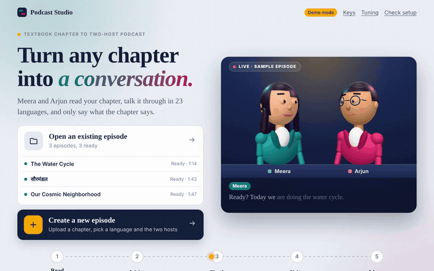

<sub>Screenshots and the clip above were recorded in <b>demo mode</b> (offline stand-in models and beep voices), so they show the interface and the checks working, not the quality of real model output.</sub>

</div>

---

## Contents

[What it does](#what-it-does) · [Screenshots](#screenshots) · [How it works](#how-it-works) · [Quick start](#quick-start) · [API keys](#api-keys) · [Using the app](#using-the-app) · [Command line](#command-line) · [Narrated video](#narrated-video) · [Configuration](#configuration) · [Codebase overview](#codebase-overview) · [Documentation](#documentation) · [Tests and code quality](#tests-and-code-quality) · [Limitations](#limitations) · [Roadmap](#roadmap) · [Contributing](#contributing) · [License](#license)

---

## What it does

Give it an NCERT-style chapter (PDF, `.txt` or `.md`, or pasted text). It writes a lively conversation between two hosts, checks every line against the chapter, records it with Indian-language voices and hands you an episode you can listen to, read along with, download and study from.

Built as the *Podcast Generation* project for **DA7016 · Recent Advances in Generative AI** (AI4Bharat).

### Key features

| | Feature | Details |
|---|---|---|
| ✅ | **Faithful to the chapter** | The chapter is cut into numbered paragraphs; every planned point points back to them. A rule rejects any **number** that is not in the chapter, and a second model fact-checks every segment. Failures go back to the writer (up to 2 repair rounds). A segment that still fails is marked **needs review**, never hidden. |
| 🗣️ | **23 languages** | English plus 22 Indian languages with 45 Bodhan voices. Write directly in the language, or write in English and translate (the English stays as the master copy that the checks run against). |
| 🎚️ | **Natural conversation** | Two hosts with their own voices, delivery styles (happy, surprise, lecture...), short reactions, overlaps, natural pacing, a jingle and loudness normalisation. |
| ✂️ | **Fix one segment, not the whole episode** | Rewrite a segment (with an instruction), re-voice it, edit a single line, or go back to an earlier version. Only that segment is redone. |
| 🧍 | **3D hosts on stage** | Two animated 3D characters (three.js) lip-sync to the audio, blink, gesture and listen while the other speaks. Falls back gracefully without WebGL. |
| 🎓 | **Study pack** | Quiz, key takeaways and glossary generated from the chapter. Every item cites its paragraph and is verified by a second model. Printable study sheet. |
| ❓ | **Ask the hosts** | Type a question; the hosts answer in their own voices, **only from the chapter**, or honestly say "that's not in the chapter". The answer is performed on the 3D stage. |
| 📊 | **Quality dashboard** | Validator score (0-100), fact-check outcomes per segment, chapter-coverage map, host balance, cost per episode and a **printable evidence report**. |
| 🎬 | **Narrated video** (optional) | Slides, the chapter's own figures and live captions, timed to the audio and built from the script itself, then encoded to MP4. |
| 🔁 | **Resumable and cheap** | Everything is saved after each step. A stopped run continues where it left off; voice clips and video frames are cached, so redoing work does not pay twice. |
| 🧪 | **Demo mode** | `--mock` runs the entire app offline with no keys and no credits. Great for trying it out and for the test-suite. |
| 🛠️ | **Developer tools** | `doctor` checks every key and model, `tune trials` compares models and creativity levels, `validate` scores any episode, a full REST API with generated docs. |

---

## Screenshots

> All screenshots are from **demo mode**: an offline stand-in writes the script and "speaks" with beeps, so the text is simple. The layout, checks, scores and interactions are the real application.

### Start here

<table>
<tr>
<td width="62%">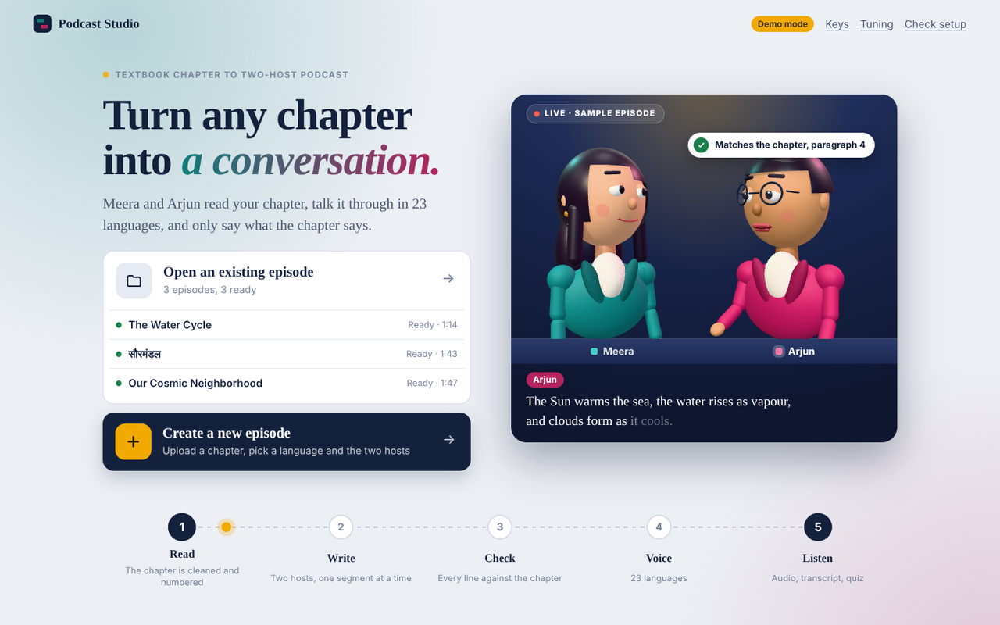</td>
<td width="38%" valign="top">

**Welcome screen.** Two clear choices: open an existing episode or create a new one. While you decide, the two hosts rehearse a short sample conversation and a badge shows a line being "matched to the chapter".

</td>
</tr>
</table>

### Create an episode

<table>
<tr>
<td width="50%">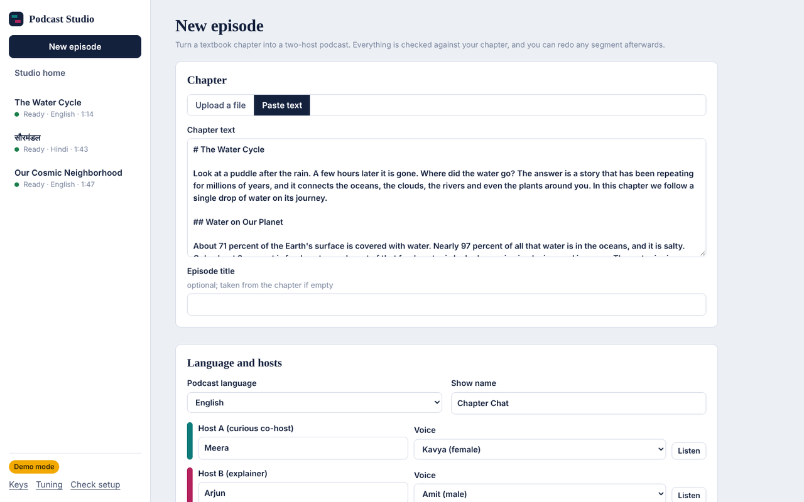</td>
<td width="50%">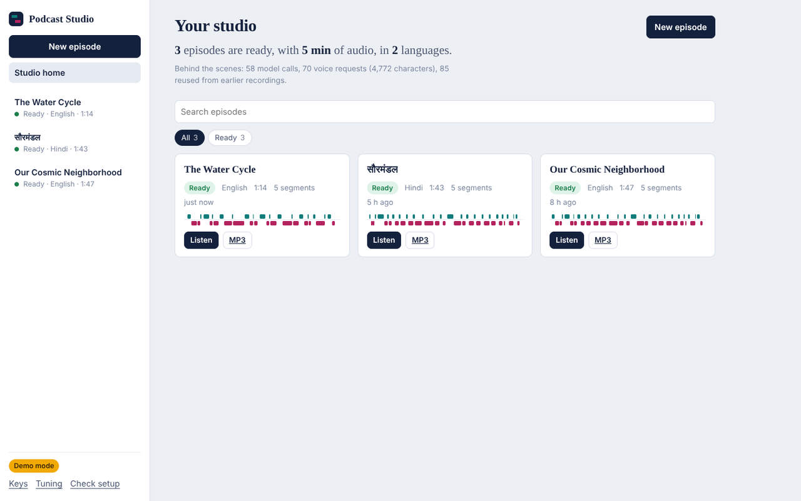</td>
</tr>
<tr>
<td><sub><b>New episode.</b> Upload a PDF or text, or paste it. Pick the language, length, hosts and voices (<i>Listen</i> previews a voice).</sub></td>
<td><sub><b>Studio home.</b> Every episode with its status, language and length.</sub></td>
</tr>
</table>

### Listen, read, fix

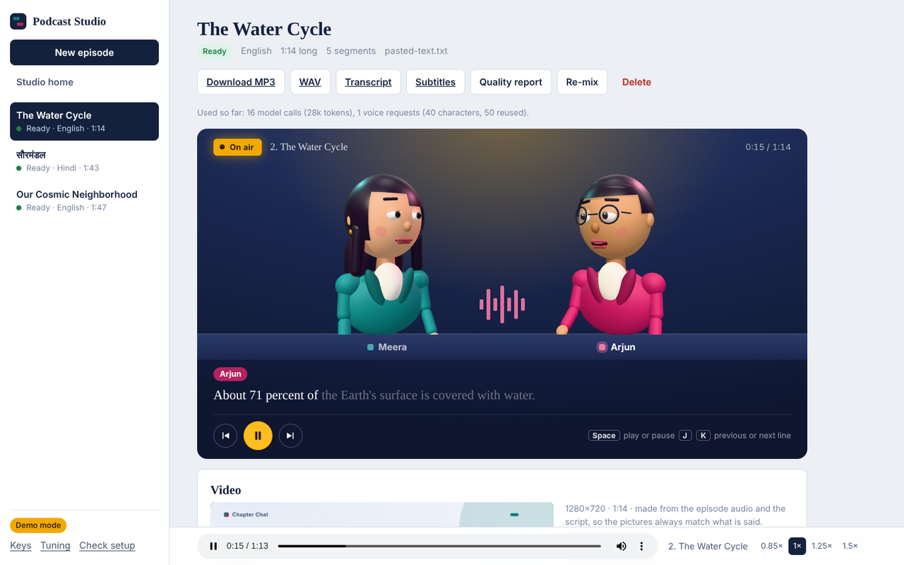

<sub><b>Episode page.</b> The 3D hosts perform the episode while captions highlight each word and the player follows along (<kbd>Space</kbd> play/pause, <kbd>J</kbd>/<kbd>K</kbd> previous/next line).</sub>

<table>
<tr>
<td width="55%">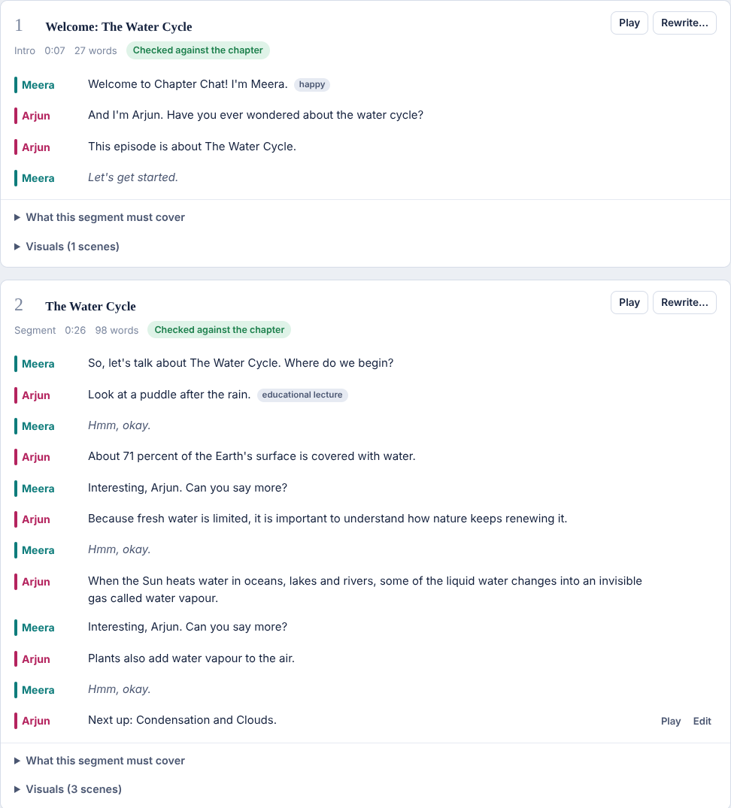</td>
<td width="45%" valign="top">

**Segment by segment.** Every segment shows its lines, length and a *Checked against the chapter* badge. Open **What this segment must cover** to see the planned key points and the chapter paragraphs it may use. Use **Rewrite...** (optionally with an instruction like "add a real-life example"), **Play**, **Edit** a single line, or revert to an earlier version. Only that segment is redone.

</td>
</tr>
</table>

### Learn, ask, check

<table>
<tr>
<td width="50%">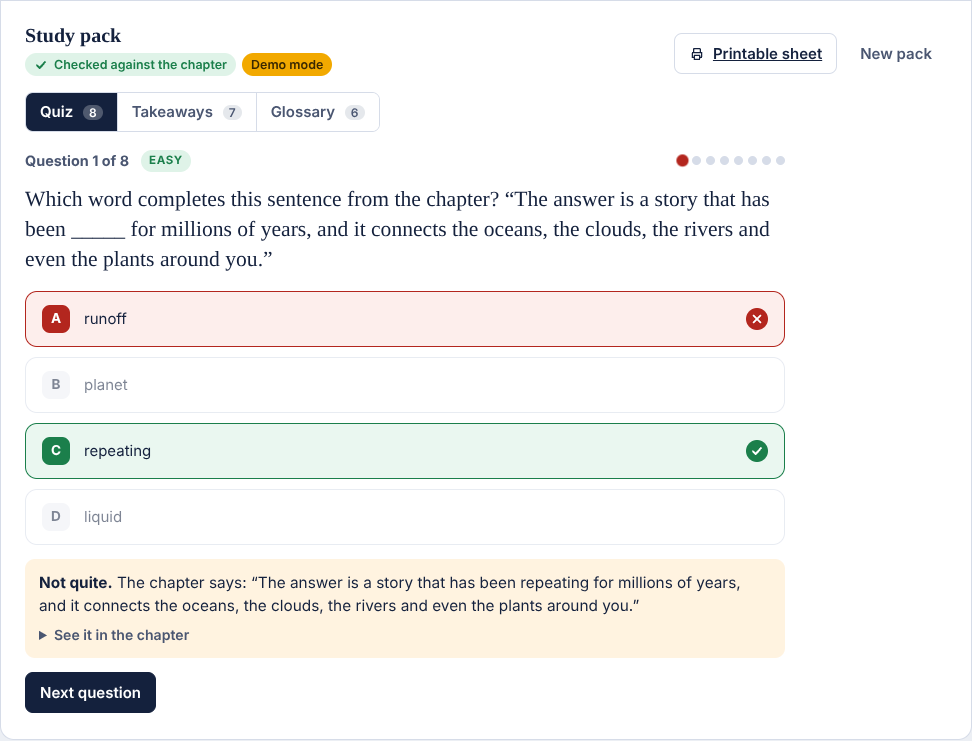</td>
<td width="50%">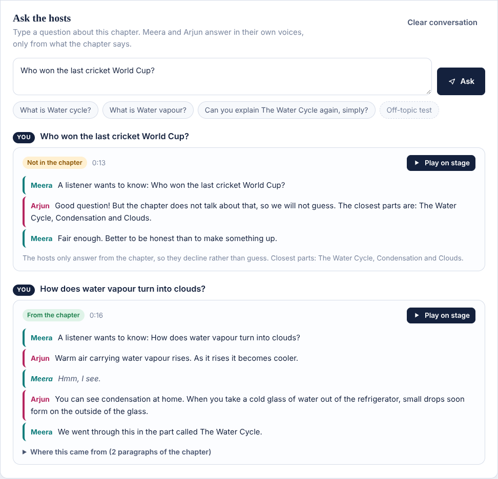</td>
</tr>
<tr>
<td><sub><b>Study pack.</b> Quiz, takeaways and glossary. A wrong answer shows the exact chapter sentence and a "See it in the chapter" link.</sub></td>
<td><sub><b>Ask the hosts.</b> Answers come only from the matching chapter paragraphs. Off-topic questions are declined, not guessed.</sub></td>
</tr>
</table>

<table>
<tr>
<td width="50%">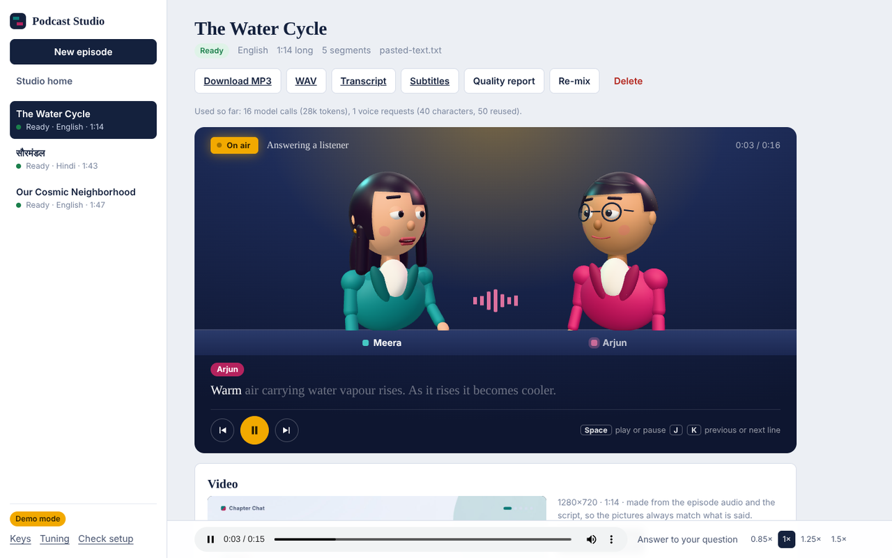</td>
<td width="50%">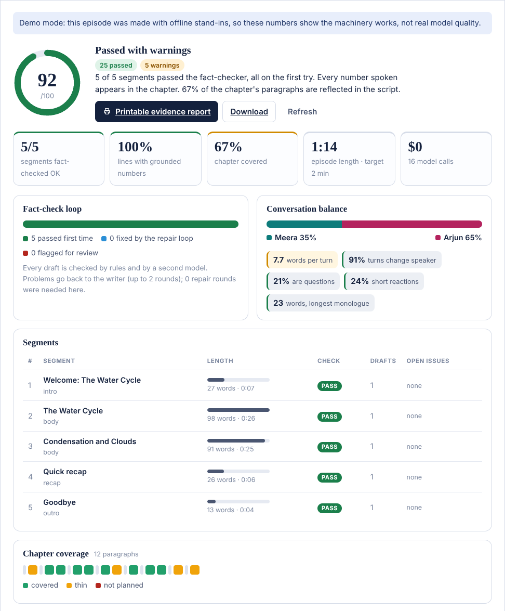</td>
</tr>
<tr>
<td><sub><b>Performed on stage.</b> An answer replaces the player's audio so the hosts' mouths and captions follow it.</sub></td>
<td><sub><b>Quality tab.</b> Score, fact-check outcomes, chapter coverage and every individual check.</sub></td>
</tr>
</table>

<table>
<tr>
<td width="55%">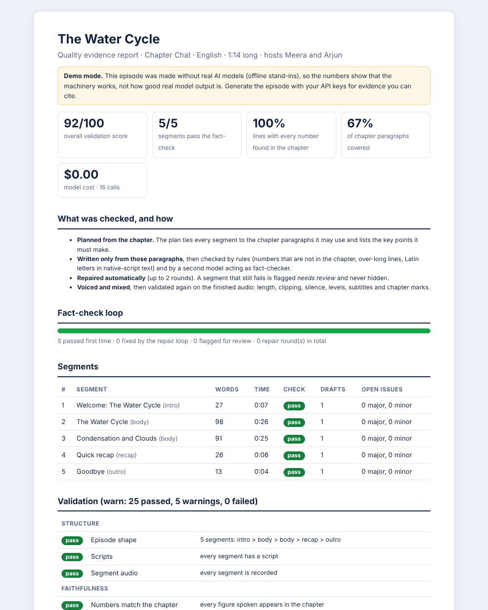</td>
<td width="45%" valign="top">

**Printable evidence report.** The same numbers on one page, ready to print or attach to a report: what was checked and how, the fact-check loop, per-segment results and every validation check with PASS / WARN / FAIL. Demo-mode episodes carry a visible banner so their numbers are never mistaken for evidence of real model quality.

</td>
</tr>
</table>

### On a phone

<p align="center">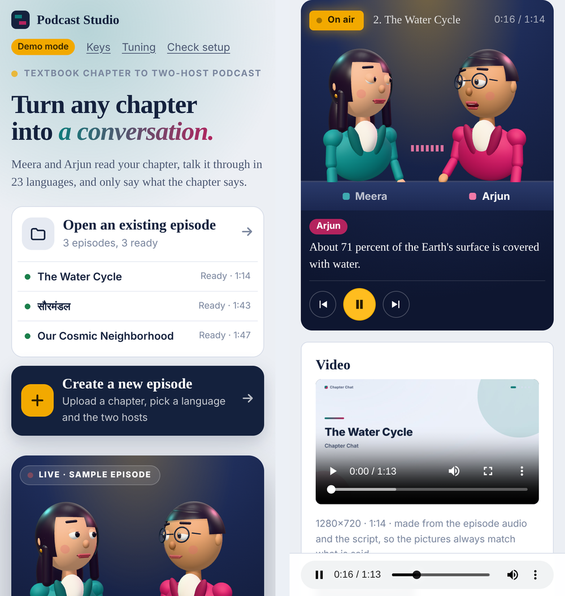</p>

---

## How it works

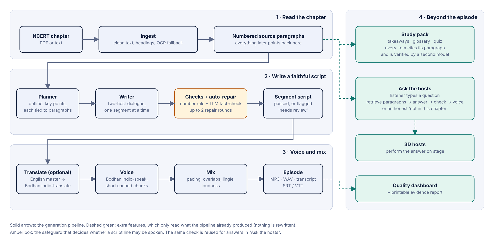

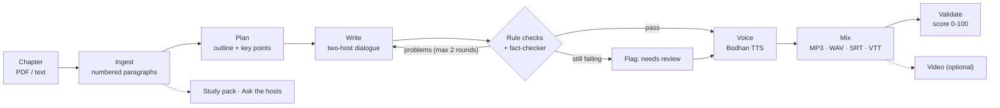

More diagrams (system overview, the repair loop, the request sequence, the episode state machine, the video pipeline) are in **[docs/ARCHITECTURE.md](docs/ARCHITECTURE.md)**.

---

## Quick start

You need **Python 3.11 or newer**. For MP3 output and loudness matching you also want **ffmpeg** (without it you still get WAV). Chrome, Edge or Playwright's Chromium is needed only for the optional video.

### Try it first, with no keys (demo mode)

```bash
git clone https://github.com/YOUR-USERNAME/podcast-studio.git
cd podcast-studio
python -m venv .venv
# Windows:  .venv\Scripts\activate        macOS / Linux:  source .venv/bin/activate
pip install -r requirements.txt
python -m podcast_studio.cli --mock serve
```

Open <http://127.0.0.1:8000>, click **Create a new episode**, choose **Paste text** and paste the contents of [`samples/water_cycle.txt`](samples/water_cycle.txt). You get a full episode with beep voices in about a minute.

### Windows, one double-click

`start.bat` creates the Python environment, installs the packages, opens `.env` in Notepad for your keys, checks that every key really works and opens the app.

### macOS / Linux

```bash
./start.sh
```

### Step by step, with real keys

```bash
python -m venv .venv
source .venv/bin/activate            # Windows: .venv\Scripts\activate
pip install -r requirements.txt
cp .env.example .env                 # Windows: copy .env.example .env
# paste your keys into .env (see the table below), then:
python -m podcast_studio.cli keys     # shows which keys are set (last 4 characters only)
python -m podcast_studio.cli doctor   # tests every key, model, voice and tool separately
python -m podcast_studio.cli serve    # http://127.0.0.1:8000
```

Install ffmpeg: `winget install Gyan.FFmpeg` (Windows), `brew install ffmpeg` (macOS), `sudo apt install ffmpeg` (Debian/Ubuntu). Reopen the terminal afterwards.

---

## API keys

Paste keys into `.env` (copied from [`.env.example`](.env.example)). **`.env` is git-ignored and must never be committed.** You can also paste keys in the app (**Keys**, bottom-left); no restart needed.

| Line in `.env` | Needed? | What it is | Where to get it |
|---|---|---|---|
| `OPENROUTER_API_KEY` | required | Language models that plan, write and fact-check | [openrouter.ai/keys](https://openrouter.ai/keys) (starts with `sk-or-`) |
| `BODHAN_TTS_API_KEY` | required | Voices, model **indic-speak** | console.bodhan.ai → API keys |
| `BODHAN_MT_API_KEY` | optional | Translation, model **indic-translate**; only for the "translate" writing mode | console.bodhan.ai → API keys |
| `BODHAN_OCR_API_KEY` | reserved | Not used yet (scanned PDFs use the OpenRouter vision model) | |

- **Several keys for one line?** Separate them with commas. If one is rejected or out of credit, the next is used automatically.
- Keys are never printed, logged, returned by the API or committed. API errors are redacted before display.
- `doctor` tests **every** key separately, so you can see exactly which one is dead or empty.

---

## Using the app

1. **Create a new episode.** Upload or paste a chapter, choose the language, length, hosts and voices.
2. **Watch progress.** Reading, planning, writing and checking each segment, then voicing and mixing. You can stop and resume at any time.
3. **Listen and read.** The 3D hosts perform the episode with synced captions. Download MP3, WAV, transcript (Markdown) or subtitles (SRT, VTT).
4. **Fix what you don't like.** Rewrite, re-voice, edit a line or revert, per segment.
5. **Study.** Open **Learn** for the quiz, takeaways and glossary, **Ask** to put your own question to the hosts.
6. **Check quality.** The **Quality** tab and the printable evidence report show what was verified and what needs review.

Episodes are saved in `data/` (git-ignored), one folder each.

---

## Command line

Everything the app does is available from the terminal: `python -m podcast_studio.cli <command>`.

| Command | What it does |
|---|---|
| `serve [--port N]` | Start the web app |
| `doctor` | Check keys, models, voices, translation, ffmpeg and video tools |
| `keys` / `setup` | Show which keys are set / guided key setup |
| `generate FILE [--lang hi] [--minutes 4] [--video] [--out DIR]` | Make an episode from a file |
| `list` | List episodes |
| `resume ID` | Continue an interrupted or failed episode |
| `regen ID N [-i "instruction"] [--revoice]` | Rewrite or re-voice segment N |
| `edit ID N LINE --text "..."` | Hand-edit one line |
| `validate [ID] [--deep]` | Quality report; `--deep` re-checks every claim with the model |
| `tune show \| set \| preset \| trials \| voices \| remix` | Pacing and creativity knobs, model comparison, voice samples |
| `video [ID]` / `vregen ID N` | Make the narrated video / redo one segment's visuals |
| `export ID --out DIR` | Copy the finished files |
| `voices`, `models QUERY` | Browse voices and OpenRouter models |

Add `--mock` before the command (`python -m podcast_studio.cli --mock generate ...`) for demo mode.

```bash
# a 4-minute Hindi episode (written directly in Hindi) from a PDF
python -m podcast_studio.cli generate chapter.pdf --lang hi --minutes 4 --out out

# compare creativity levels on your own chapter, script only (no voice credits)
python -m podcast_studio.cli tune trials --file samples/water_cycle.txt --temps 0.5,0.85,1.0

# rewrite segment 3 with an instruction
python -m podcast_studio.cli regen <id> 3 -i "add a real-life example"
```

`validate` scores five areas with PASS / WARN / FAIL per check: **structure**, **faithfulness** (numbers, key points, coverage, open issues), **naturalness** (turn length, back-and-forth, reactions, host balance, repetition), **audio** (length, clipping, level, silence, MP3) and **outputs** (subtitles match the script, chapter marks in order).

---

## Narrated video

An optional step that turns a finished episode into an MP4: slides that appear **as the hosts say them** (key terms, bullet points, numbered steps, cycles with arrows, comparison tables, big numbers, the chapter's own figures, recap), live captions with the speaker's name and cross-fades, all timed to the audio.

```bash
pip install -r requirements.txt            # already includes pillow and playwright
python -m playwright install chromium      # ~150 MB; not needed if Edge or Chrome is installed
python -m podcast_studio.cli doctor        # should show "Video renderer" and "Video encoder"
python -m podcast_studio.cli video <id> --res 720p --theme dark
```

The video follows the same rule as the script: the director model may only use words and numbers from the script and the chapter, rules verify it, problems go back for repair, and anything still wrong is replaced by a safe slide built from the script itself. See [ARCHITECTURE.md](docs/ARCHITECTURE.md#narrated-video).

---

## Configuration

| Where | What |
|---|---|
| [`.env`](.env.example) | Keys, model names (`LLM_MODEL_WRITER`, `LLM_MODEL_CHECKER`, ...), `TTS_CONCURRENCY`, `DATA_DIR`, `MOCK_APIS` |
| [`tuning.json`](tuning.example.json) | How it sounds and reads: temperatures, speaking speed, pauses, overlaps, loudness, jingle. Also the **Tuning** button in the app. Presets: `faithful`, `balanced`, `lively`, `calm`. Out-of-range values are clamped, so typos cannot break a run. |
| Per episode | Language, length, hosts and voices, fact-check on/off, review the script before voicing, extra instructions (form or `generate --help`) |

---

## Codebase overview

```text
podcast-studio/
├── podcast_studio/              the Python package (~9,000 lines)
│   ├── api.py                   FastAPI app: REST routes, job submission, static files
│   ├── cli.py                   command-line interface (generate, validate, tune, video, ...)
│   ├── models.py                pydantic data model: Project, Segment, Turn, CheckReport, ...
│   ├── store.py                 one JSON file + audio per episode, atomic writes
│   ├── jobs.py                  background jobs: one per episode, progress, cancel
│   ├── config.py · keys.py      settings from .env, key rotation and masking
│   ├── ingest.py · text.py      PDF/text to clean numbered paragraphs, OCR fallback, text helpers
│   ├── prompts.py               every prompt sent to a model, in one place
│   ├── voices.py                languages, voices, delivery styles
│   ├── audio.py                 WAV/MP3 helpers: trim, level, overlay, loudness, jingle
│   ├── validate.py              the 0-100 quality validator
│   ├── doctor.py · setup_wizard.py · tune.py · tuning.py   setup check, key wizard, tuning knobs
│   ├── pipeline/
│   │   ├── orchestrator.py      generate / voice / remix / regenerate, resumable
│   │   ├── planner.py           outline + key points, tied to source paragraphs
│   │   ├── writer.py            dialogue per segment + the fact-check and repair loop
│   │   ├── checks.py            rule checks and the LLM fact-checker
│   │   ├── voice.py             chunking, cached TTS, pacing
│   │   └── assemble.py          mix, chapter marks, MP3/WAV, SRT/VTT/Markdown
│   ├── extras/                  study pack, Ask the hosts, Quality dashboard (isolated, mounted in one call)
│   │   ├── learn.py · ask.py · insights.py · render.py · routes.py · common.py
│   ├── video/                   director, figures, timeline, HTML slide templates, Chromium renderer, ffmpeg mux
│   └── clients/                 the only code that touches the network
│       ├── openrouter.py        chat models: retries, fallbacks, key rotation, JSON repair
│       ├── bodhan.py            TTS and translation
│       └── mock.py              offline stand-ins for demo mode and tests
├── static/                      the web UI: plain HTML / CSS / JavaScript, no build step
│   ├── app.js · app.css         single-page app
│   ├── extras.js · extras.css   Learn / Ask / Quality tabs
│   └── stage3d.js               built 3D hosts (generated from web3d/)
├── web3d/                       source of the 3D hosts (three.js + esbuild; `npm ci && npm run build`)
├── tests/                       180+ tests, no credits needed (offline fakes and local fake HTTP servers)
├── docs/                        ARCHITECTURE.md · API.md · DATA_MODEL.md · openapi.json · schemas/ · images/
├── scripts/export_docs.py       regenerates the JSON Schemas, OpenAPI file and the generated docs
├── samples/water_cycle.txt      a short original sample chapter
├── .github/workflows/ci.yml     lint + tests on Python 3.11, 3.12, 3.13
├── .env.example · tuning.example.json · start.bat · start.sh
└── pyproject.toml · requirements*.txt
```

**Reading order for a new contributor:** `models.py` → `pipeline/orchestrator.py` → `pipeline/writer.py` → `pipeline/checks.py` → `api.py`.

---

## Documentation

| Document | Contents |
|---|---|
| [docs/ARCHITECTURE.md](docs/ARCHITECTURE.md) | System overview, pipeline, repair loop, request sequence, state machine, video pipeline, storage layout, design decisions |
| [docs/DATA_MODEL.md](docs/DATA_MODEL.md) | Class diagram of every stored object, on-disk layout, an example `project.json` |
| [docs/API.md](docs/API.md) | Every REST endpoint with what it does (generated) |
| [docs/openapi.json](docs/openapi.json) | Machine-readable OpenAPI spec; with the app running, Swagger UI is at `/api/docs` |
| [docs/schemas/](docs/schemas) | JSON Schemas for `Project`, `Segment`, `Turn`, `CheckReport`, ... (generated from the pydantic models) |
| [CONTRIBUTING.md](CONTRIBUTING.md) | Dev setup, tests, lint, regenerating docs, rebuilding the 3D hosts |

Every module, class and function has a docstring; the generated docs are rebuilt with `python scripts/export_docs.py`.

---

## Tests and code quality

```bash
pip install -r requirements-dev.txt
pytest --ignore=tests/test_video.py     # fast set (a few minutes), no credits used
pytest                                  # everything, including the video tests (needs Chromium and ffmpeg)
ruff check .                            # lint (config in pyproject.toml)
```

- **180+ tests**, all offline. Besides unit tests there are local HTTP servers that mimic OpenRouter and Bodhan, so the real client code (retries, fallbacks, key rotation, error handling, request shapes) is exercised, and whole-pipeline tests with injected failures (bad JSON, exhausted repairs, cancel and resume).
- The video tests render real slides in Chromium and encode real MP4s; they skip themselves with a clear reason if the browser or ffmpeg is missing.
- GitHub Actions ([`ci.yml`](.github/workflows/ci.yml)) runs ruff and the fast tests on Python 3.11, 3.12 and 3.13 for every push and pull request.

---

## Limitations

Honest notes so nobody is surprised:

- **Real-model quality is not benchmarked here.** The screenshots are demo mode. The Quality tab reports what the checks found for *your* run; this repository makes no claim about scores with any particular model.
- **The fact-checker is itself a model.** The number rule is exact, but the claim check can miss a subtle error. That is why unresolved segments are flagged *needs review* and the evidence report lists them.
- **Chapters are trusted input.** The chapter text is sent to the models inside delimited blocks, but there is no dedicated defence against instructions hidden inside a chapter. Use chapters you trust.
- **Local tool, no login.** The server binds to `127.0.0.1` and only accepts key changes from the same computer. Do not expose it to the internet as it stands.
- **Needs internet, keys and credits** for real episodes. English has no dedicated Bodhan voice, so try several voices.
- **Video** needs Chromium (or Edge/Chrome) and ffmpeg with H.264, and takes noticeably longer than audio.
- **Platforms.** Developed and used mostly on Windows; the macOS/Linux scripts and CI cover the rest.
- **Scanned PDFs** are read with a vision model through OpenRouter; very poor scans may need a cleaner copy.
- The sample chapter in `samples/` is original text written for this project. **NCERT chapters are not included**; use your own copies.

## Roadmap

- Real-run evaluation set (several chapters × several models) published alongside the code
- More host personalities and per-language style presets
- Optional password and per-user folders so it can be shared on a network
- A hosted, containerised demo (Docker image)
- Retrieval-augmented fact-checking across multiple chapters (a whole book)

## Contributing

Issues and pull requests are welcome. Please read [CONTRIBUTING.md](CONTRIBUTING.md) first; in short: keep `ruff check .` clean, add a test for behaviour you change, and never commit keys or generated episodes.

## License

[MIT](LICENSE). Third-party services (OpenRouter, Bodhan) have their own terms. Models and voices are used through their APIs and are not part of this repository.

## Acknowledgements

[Bodhan](https://console.bodhan.ai) for Indian-language speech and translation, [OpenRouter](https://openrouter.ai) for model access, [three.js](https://threejs.org) for the 3D hosts, [FastAPI](https://fastapi.tiangolo.com) and [pydantic](https://docs.pydantic.dev).
