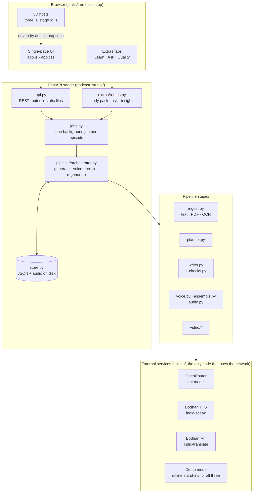
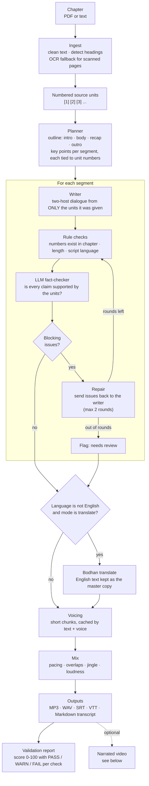
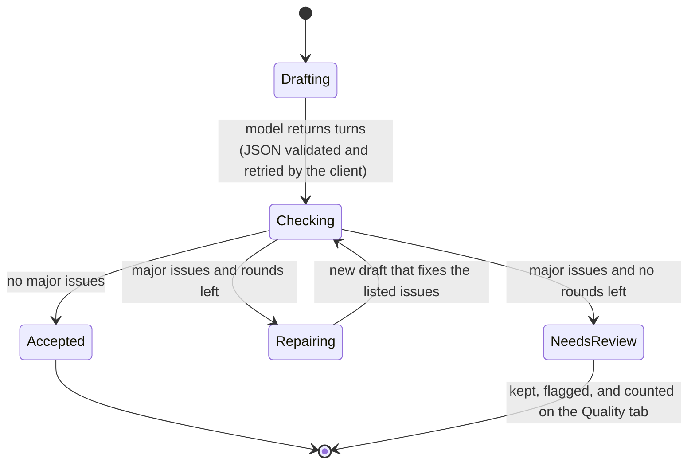
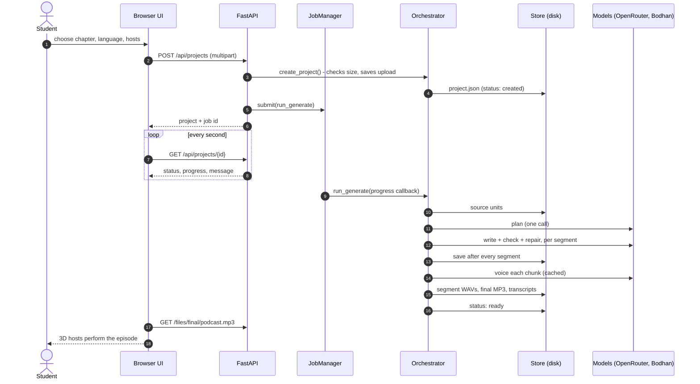
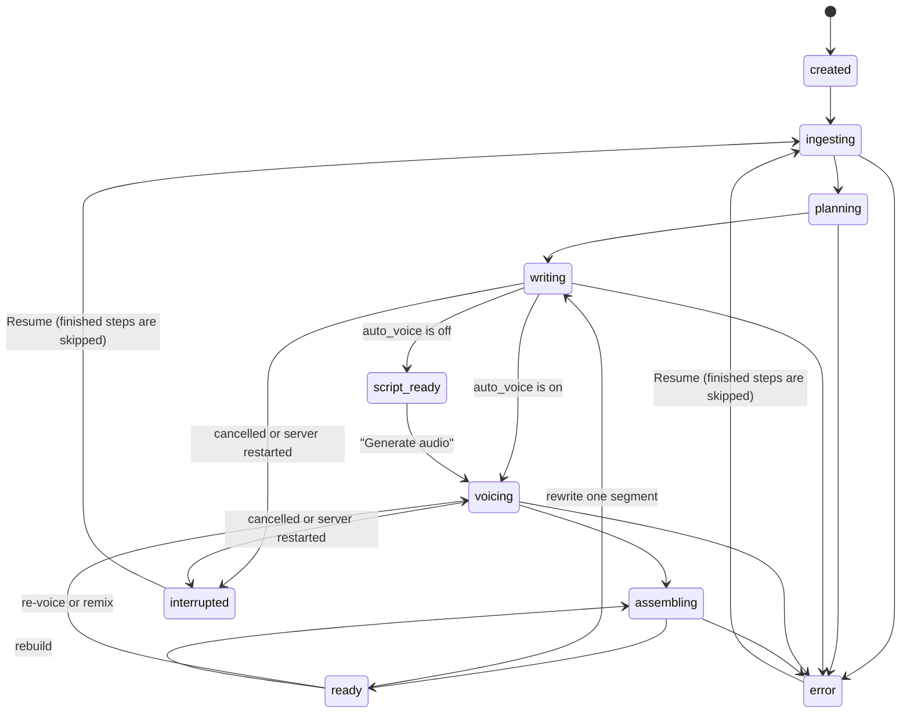
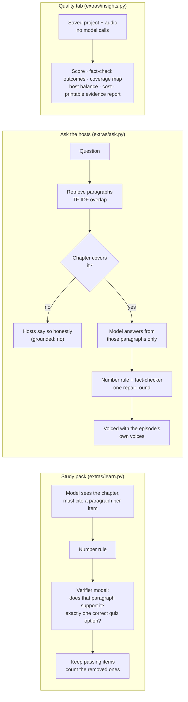
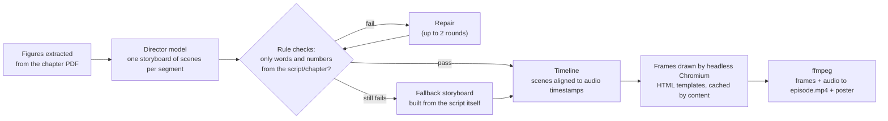

# Architecture

This page explains how Podcast Studio is built and, more importantly, **why**. All diagrams are [Mermaid](https://mermaid.js.org), so they render directly on GitHub and stay in sync with the text.

- [The one rule everything is built around](#the-one-rule-everything-is-built-around)
- [System overview](#system-overview)
- [Generation pipeline](#generation-pipeline)
- [The fact-check and repair loop](#the-fact-check-and-repair-loop)
- [What happens when you press "Create episode"](#what-happens-when-you-press-create-episode)
- [Episode life cycle](#episode-life-cycle)
- [Study pack, Ask the hosts and Quality tab](#study-pack-ask-the-hosts-and-quality-tab)
- [Narrated video](#narrated-video)
- [Where files are stored](#where-files-are-stored)
- [The 3D hosts](#the-3d-hosts)
- [Design decisions](#design-decisions)
- [Testing strategy](#testing-strategy)
- [Where to extend it](#where-to-extend-it)

Related: [`DATA_MODEL.md`](DATA_MODEL.md) (every stored object), [`API.md`](API.md) (every endpoint), [`schemas/`](schemas) (JSON Schemas).

---

## The one rule everything is built around

A podcast made from a school textbook has one job above all: **never say something the chapter does not say.**

So the chapter is cut into *numbered paragraphs* once, and every later stage has to point back to those numbers. The script is checked by a fixed rule (every number spoken must exist in the chapter) and by a second model acting as fact-checker. A segment that still fails after repair is shown as **needs review**, never quietly accepted. The study pack, the "Ask the hosts" answers and the video storyboards reuse the same safeguards, so "everything is grounded in the chapter" is one claim, not four.

---

## System overview



| Layer | Files | Responsibility |
|---|---|---|
| Web UI | `static/app.js`, `static/extras.js`, `static/stage3d.js` | Plain JavaScript, no framework, no bundler for the app itself. The 3D hosts are the only built asset (see [The 3D hosts](#the-3d-hosts)). |
| HTTP | `podcast_studio/api.py`, `podcast_studio/extras/routes.py` | Thin: validate input, start a job or return stored data. Handlers contain no pipeline logic. |
| Jobs | `podcast_studio/jobs.py` | A small thread-based job manager. One running job per episode (a second request gets `409`), progress polling, cooperative cancel. |
| Orchestration | `podcast_studio/pipeline/orchestrator.py` | Sequences the stages, writes results to the store after every step so a stopped run can resume. |
| Stages | `ingest.py`, `pipeline/*`, `video/*`, `extras/*` | One module per stage, each testable alone. |
| Clients | `podcast_studio/clients/*` | The only code that talks to the network. `mock.py` is a drop-in offline twin used by demo mode and tests. |
| Storage | `podcast_studio/store.py`, `models.py` | Pydantic models saved as one `project.json` per episode (atomic writes). No database. |

---

## Generation pipeline



Two writing modes exist for non-English episodes: **direct** (the model writes straight in the target language) and **translate** (it writes in English, then Bodhan translates; the English stays as the master copy that the checks run against).

---

## The fact-check and repair loop

The loop is the heart of the project. It lives in [`pipeline/writer.py`](../podcast_studio/pipeline/writer.py) (`ScriptWriter.write`).



| Check | Type | What it catches |
|---|---|---|
| Numbers rule | rule | Any figure spoken that does not appear in the chapter or the segment's key points (Indic digits are normalised first). Always a major issue. |
| Script rule | rule | Latin letters inside a Hindi/Tamil/... line (the voice engine needs native script); turns over 95 words. |
| Length rule | rule | A segment more than twice, or under 40 %, of its target length. |
| Fact-checker | model | A claim the cited paragraphs do not support, and planned key points that are missing from the dialogue. Returns issues with a severity and a suggested fix. |

Issues are structured (`Issue`: turn, severity, type, detail, suggested fix; see [`DATA_MODEL.md`](DATA_MODEL.md)), so the repair prompt can quote exactly what to fix.

---

## What happens when you press "Create episode"



Everything the browser does is a plain HTTP call, so the same endpoints can be driven by the tests or by a script of your own.

---

## Episode life cycle

An episode's `status` field only ever takes these values, so the UI and the resume logic can be written against a closed set.



Because the store is written after each step, **Resume** only does the work that is missing: finished segments and cached voice chunks are skipped.

---

## Study pack, Ask the hosts and Quality tab

These three features were added on top of the pipeline and are deliberately isolated in `podcast_studio/extras/`. They are mounted by one function call (`mount_extras`) and the UI loads them only if `GET /api/extras` answers.



Every one of these has an **offline twin** for demo mode, built from the chapter's own sentences, so the whole app can be demonstrated and tested without API credits. Demo-mode reports carry a visible "Demo mode" banner so the numbers are never mistaken for evidence of real model quality.

---

## Narrated video

The video is optional and built **after** the audio is finished, so a video failure can never damage the episode.



Re-running reuses every storyboard and frame that is unchanged, so redoing one segment costs only that segment's visuals.

---

## Where files are stored

Everything lives under `DATA_DIR` (default `./data`, git-ignored). There is no database; each episode is a folder you can copy, back up or delete.

```text
data/
├── projects/<episode-id>/
│   ├── project.json            all state: settings, plan, segments, versions, checks, usage
│   ├── source/                 the upload, extracted text, numbered units
│   ├── segments/segNN_vK.wav   audio of segment NN, version K (older versions are kept)
│   ├── final/                  podcast.mp3 · podcast.wav · transcript.md/.srt/.vtt
│   ├── reports/validation.json the last quality report
│   ├── extras/                 learn.json · history.json · ask_NNN.wav
│   └── video/                  episode.mp4 · poster.jpg · scenes/
└── cache/
    ├── tts/                    voice chunks keyed by (model, voice, language, style, text)
    ├── frames/                 rendered video frames keyed by content
    └── pages/                  rendered PDF pages (for figures and OCR)
```

Writes go through `util.atomic_write_*` (temp file then rename), so a crash can leave an old file but never a half-written one.

---

## The 3D hosts

The two hosts are real-time 3D characters built with [three.js](https://threejs.org), with lip-sync driven by the audio level and the caption timing, plus blinking, head sway, gestures and a listening pose for the host who is not talking.

| | |
|---|---|
| Source | [`web3d/src/stage3d.js`](../web3d/src/stage3d.js) |
| Built file | `static/stage3d.js` (committed, so the app works with no Node.js installed) |
| Rebuild | `cd web3d && npm ci && npm run build` (esbuild, three.js pinned in `package-lock.json`) |
| Fallback | Without WebGL, the stage shows plain name badges; audio, captions and transcript still work. |

---

## Design decisions

| Decision | Why |
|---|---|
| **Honest failure over fluent failure** | "needs review", "n items removed" and "the chapter does not say" are visible and counted. A podcast that sounds right but is wrong is worse than one that admits a gap. |
| **One safeguard, reused** | The same number rule and fact-checker guard scripts, quiz items, spoken answers and storyboards. |
| **JSON on disk instead of a database** | An episode is a folder. Easy to inspect, back up and resume; nothing to install. |
| **Pydantic models are the contract** | `models.py` validates every load and save and generates the [JSON Schemas](schemas) automatically. |
| **Resumable by construction** | State is saved after each step; every expensive output (voice chunks, frames) is cached by content. |
| **Additive extras** | New features live in one folder plus one `mount_extras()` call. A failure there cannot break episode generation. |
| **Offline twins for every model call** | Fast deterministic tests, a free demo mode, and no surprise bills while developing. |
| **No front-end framework** | The UI is small enough for plain JavaScript; no build step means one less thing to break for a student running it on a laptop. |
| **Local tool, local trust model** | The server binds to `127.0.0.1`, has no login, and only accepts key changes from the same computer. It is not meant to be exposed to the internet as it stands. |

---

## Testing strategy

| Area | Tests | How |
|---|---|---|
| Text, chunking, audio helpers | `tests/test_text_audio.py`, `tests/test_ingest.py` | Pure functions: sentence splitting, number checks, WAV handling, silence trimming, PDF/text ingest. |
| Clients | `tests/test_clients.py`, `tests/test_keys.py` | The real HTTP clients against tiny fake servers (`tests/fake_servers.py`): retries, key rotation, error messages that never leak a key. |
| Pipeline | `tests/test_pipeline.py` | Whole generate / regenerate / resume flows on the offline stand-ins, with failure injection (bad JSON, repair exhaustion, cancel). |
| Tools | `tests/test_tools.py` | Validator, tuning, setup wizard, tune trials, CLI. |
| API and extras | `tests/test_api.py`, `tests/test_extras.py` | FastAPI `TestClient`: cache headers, job conflicts, path safety, study pack, Ask, Quality, and a guard that `extras.css` never restyles the main app. |
| Video | `tests/test_video.py` | Renders real frames in headless Chromium (slow; not run in CI, run it locally). |

Run `pytest` for the quick set; see the [README](../README.md#tests-and-code-quality).

---

## Where to extend it

| You want to... | Touch |
|---|---|
| Add a language | `podcast_studio/voices.py` (language and voice table) |
| Use a different chat model | `.env` (`LLM_MODEL_WRITER`, `LLM_MODEL_CHECKER`, ...) or the `tune trials` CLI to compare models |
| Add a new check | `pipeline/checks.py` (a script, while writing) or `validate.py` (a finished episode) and a test next to it |
| Add a new output format | `pipeline/assemble.py` (`write_transcripts`) |
| Add a new "extras" feature | a new module in `podcast_studio/extras/`, routes in `extras/routes.py`, a tab in `static/extras.js` |
| Swap a service provider | implement the methods of `clients/openrouter.py` / `clients/bodhan.py` in a new client and return it from `make_clients` |
