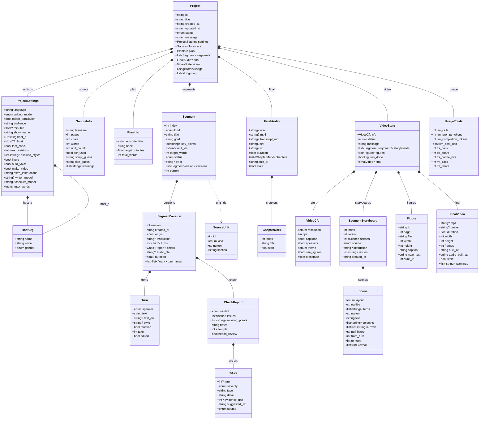

# Data model

Everything an episode needs is one `project.json` plus audio files, so a stopped run can resume and nothing hides in a database. The models are [pydantic](https://docs.pydantic.dev) classes in [`podcast_studio/models.py`](../podcast_studio/models.py); their JSON Schemas are in [`schemas/`](schemas/). This page is generated by `scripts/export_docs.py`.

## Class diagram



How to read it: a `Project` has settings, source facts, a plan, a list of **segments**, the final audio and the video state. Each segment keeps **every version** of its script (`SegmentVersion`: the lines, their check result, the audio and per-line timings), and `current` says which one is in use. That is what makes *Rewrite*, *Re-voice*, *Edit line* and *History* cheap and reversible. A segment points at the chapter paragraphs it covers through `unit_ids`; those are the numbered `SourceUnit`s every claim must trace back to.

## On disk

```text
data/                                   (git-ignored; set another folder with DATA_DIR in .env)
├── projects/
│   └── <project-id>/                   one folder per episode, e.g. 261030-46efbf
│       ├── project.json                everything about the episode (the `Project` model above)
│       ├── source/
│       │   ├── <your upload>           the PDF or text exactly as uploaded
│       │   ├── source.txt              cleaned chapter text
│       │   └── units.json              the numbered source paragraphs (`SourceUnit` list)
│       ├── segments/segNN_vK.wav       the audio of segment NN, script version K
│       ├── final/                      podcast.mp3, podcast.wav, transcript.md / .srt / .vtt
│       ├── reports/validation.json     the last quality report
│       ├── extras/                     learn.json (study pack), history.json + ask_NNN.wav (Ask the hosts)
│       └── video/                      episode.mp4, poster.jpg, scenes/ (slide thumbnails), storyboards in project.json
├── cache/
│   ├── tts/                            every recorded voice chunk (re-used, so re-mixing costs no voice credits)
│   ├── frames/                         every drawn video frame
│   └── pages/                          page images used for OCR of scanned PDFs
└── (fonts/ next to data/             optional .ttf/.otf files for the video slides)

```

## A real example

Trimmed from a demo-mode run of `samples/water_cycle.txt` (so the wording is placeholder text, but the structure is exactly what real runs write).

**A source paragraph** (`source/units.json`):

```json
{
  "id": 2,
  "kind": "para",
  "text": "Look at a puddle after the rain. A few hours later it is gone. Where did the water go? The answer is a story that has been repeating for millions of years, and it connects the oceans, the clouds, the rivers and even the plants around you. In this chapter we follow a single drop of water on its journey.",
  "section": "The Water Cycle"
}
```

**A segment** (in `project.json`):

```json
{
  "index": 1,
  "kind": "body",
  "title": "The Water Cycle",
  "goal": "Understand The Water Cycle",
  "key_points": [
    "Look at a puddle after the rain.",
    "About 71 percent of the Earth's surface is covered with water.",
    "Because fresh water is limited, it is important to understand how nature keeps renewing it.",
    "When the Sun heats water in oceans, lakes and rivers, some of the liquid water changes into an invisible gas called water vapour.",
    "Plants also add water vapour to the air."
  ],
  "unit_ids": [
    2,
    4,
    5,
    7,
    8,
    10
  ],
  "target_words": 116,
  "status": "ready",
  "current": 1
}
```

**One version of that segment**: two of its lines, the fact-check result, its audio and timings:

```json
{
  "version": 1,
  "origin": "generated",
  "duration": 25.85,
  "turns": [
    {
      "speaker": "A",
      "text": "So, let's talk about The Water Cycle. Where do we begin?",
      "text_en": null,
      "style": null,
      "reaction": false,
      "take": 0,
      "edited": false
    },
    {
      "speaker": "B",
      "text": "Look at a puddle after the rain.",
      "text_en": null,
      "style": "educational lecture",
      "reaction": false,
      "take": 0,
      "edited": false
    }
  ],
  "check": {
    "verdict": "pass",
    "issues": [],
    "missing_points": [],
    "notes": "mock checker",
    "attempts": 1,
    "needs_review": false
  },
  "audio_file": "segments/seg02_v1.wav",
  "turn_times": [
    [
      0.2,
      2.68
    ],
    [
      3.046,
      4.356
    ]
  ]
}
```

**What the episode cost** (`usage`):

```json
{
  "llm_calls": 11,
  "llm_prompt_tokens": 19038,
  "llm_completion_tokens": 1420,
  "llm_cost_usd": 0.0,
  "tts_calls": 25,
  "tts_chars": 1262,
  "tts_cache_hits": 8,
  "mt_calls": 0,
  "mt_chars": 0
}
```

